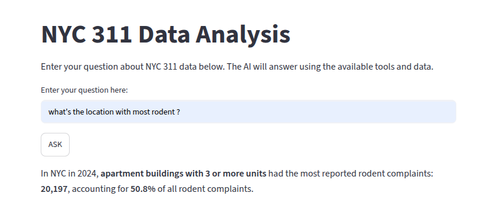
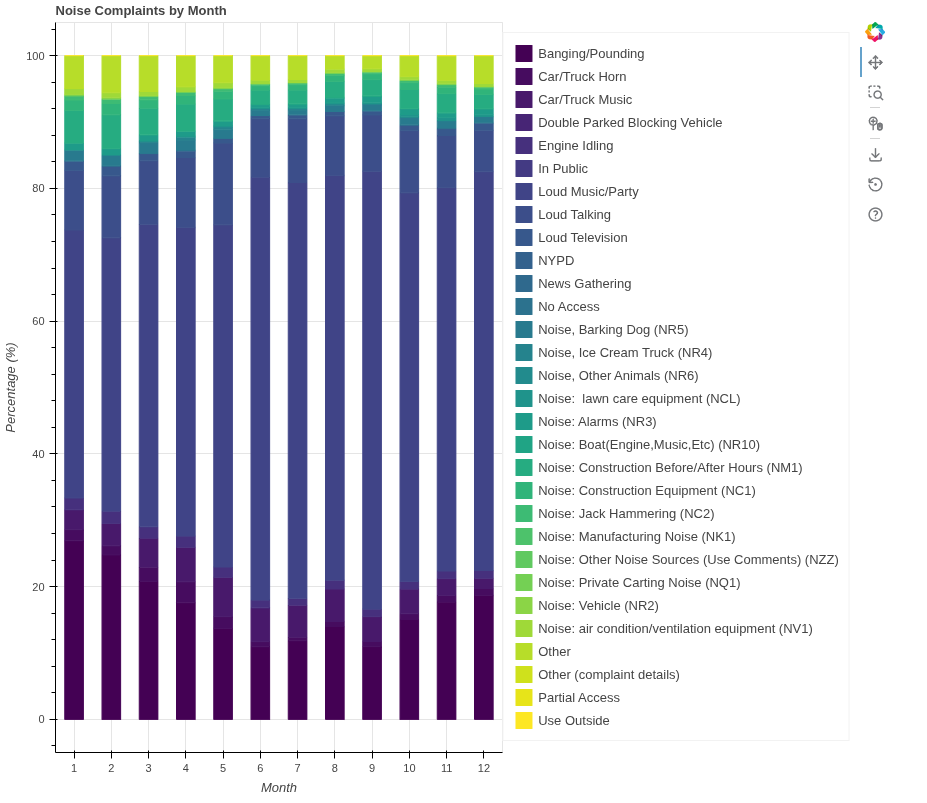
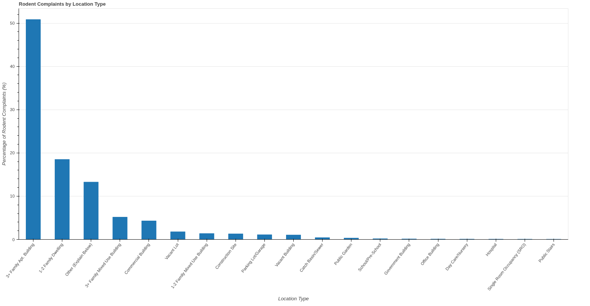
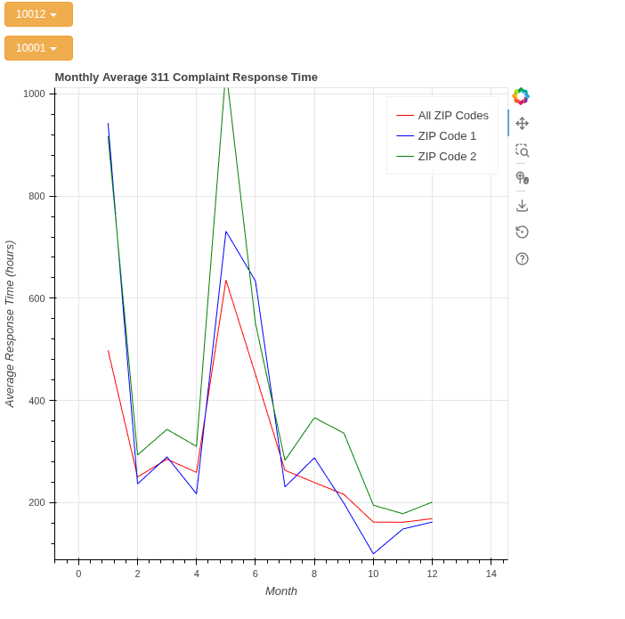

# NYC 311 Data Analysis with LLM

A Python-based data analytics application that explores New York City's 311 service requests from 2024, combining data processing, interactive visualizations, and an LLM-powered assistant.

Originally developed as part of COMP 370 coursework at McGill University, this project brings together multiple data analysis assignments into a single application. It integrates an OpenAI language model with Python function calling, allowing users to ask natural-language questions about NYC 311 complaints and receive answers based on processed datasets.

## Features

- Data cleaning and preprocessing of NYC 311 service requests
- Complaint analysis by borough and date range
- Monthly complaint response time analysis by ZIP code
- Noise complaint analysis by month and descriptor
- Rodent complaint analysis by location type
- Interactive data visualizations using Bokeh
- LLM-powered assistant using OpenAI function calling to retrieve statistics from processed data
- Web-based interface built with Streamlit
- Automated unit testing using pytest
- Continuous Integration (CI) with GitHub Actions

## Technologies Used

- **Language:** Python
- **Data Analysis:** Pandas, NumPy
- **Visualization:** Matplotlib, Bokeh
- **AI Integration:** OpenAI API, LLM Function Calling
- **Web Interface:** Streamlit
- **Testing:** pytest
- **CI:** GitHub Actions
- **Version Control:** Git, GitHub

## Project Structure

- `src/` -> Reusable data cleaning, processing, and analysis functions
- `src/llm/` -> LLM agent implementation and Python functions exposed through function calling
- `scripts/` -> Data preprocessing and analysis scripts
- `dashboards/` -> Interactive data visualizations using Bokeh
- `data/raw/` -> Original NYC 311 datasets
- `data/processed/` -> Cleaned datasets and precomputed statistics
- `notebooks/` -> Exploratory data analysis using Jupyter notebooks
- `tests/` -> Automated unit tests using pytest
- `.github/workflows/` -> GitHub Actions CI workflow
- `docs/` -> Project documentation
- `app.py` -> Streamlit web application

## Installation

Clone the repository and navigate to the project directory.

Create and activate a virtual environment:

```bash
python3 -m venv .venv
source .venv/bin/activate
```

Install the required dependencies:

```bash
python -m pip install -r requirements.txt
```

To use the LLM assistant, create a `.env` file in the project root and configure your OpenAI API key:

```env
OPENAI_API_KEY=your_api_key_here
```

The `.env` file should not be committed to GitHub.

The application also requires the relevant processed NYC 311 datasets in `data/processed/`.

## Run

### LLM-Powered Assistant

Launch the Streamlit interface:

```bash
streamlit run app.py
```

The application allows users to ask questions about NYC 311 data through a browser-based interface.

Example questions:

- What was the most common noise complaint in July 2024?
- Which location type had the most reported rodent complaints in 2024?
- Which ZIP code had the slowest average complaint response time in January?
- Compare the fastest and slowest ZIP codes in July 2024.

The LLM selects relevant Python functions to retrieve statistics from the processed datasets and presents the results in natural language.

### Bokeh Dashboards

Run the noise and rodent dashboards:

```bash
python -m dashboards.noise_dashboard
python -m dashboards.rodent_dashboard
```

Launch the interactive response time dashboard:

```bash
PYTHONPATH=. bokeh serve dashboards/response_time_dashboard.py --show
```

## Screenshots

### LLM-Powered Assistant



### Noise Complaints Dashboard



### Rodent Complaints Dashboard



### Response Time Dashboard



## Testing

Run the automated tests:

```bash
python -m pytest tests/ -v
```

The project also includes a GitHub Actions workflow to execute automated tests on repository updates.

## How the LLM Integration Works

1. The user submits a natural-language question through Streamlit.
2. The application sends the question and available tool definitions to the OpenAI API.
3. The LLM selects an appropriate function and provides its arguments.
4. The Python application executes the function to retrieve statistics from processed NYC 311 data.
5. The result is returned to the LLM, which generates a natural language answer.

The application maintains conversation context across questions within the same session, allowing users to ask follow-up questions.

## Project Background

This project originated from COMP 370 coursework at McGill University and was subsequently extended into a unified data analytics application.

The original assignments focused on data preprocessing, statistical analysis and visualization of NYC 311 service requests. The project was further developed by integrating an LLM agent with function calling, a Streamlit interface, automated unit tests and a GitHub Actions CI workflow.

The goal is to demonstrate the integration of traditional data analytics techniques with modern LLM-based applications and software engineering practices.